# EventCraft AI – Celebration & Event Planner ✨

[](https://github.com/eventcraft-ai/eventcraft/actions)
[](https://opensource.org/licenses/MIT)
[](https://www.typescriptlang.org/)
[](https://nodejs.org/)
[](https://react.dev/)

> **EventCraft AI** is a production-grade, full-stack GenAI planning assistant engineered for weddings, milestone birthdays, and community festivals. It delivers balanced budgets in INR, week-by-week countdown timelines, vendor due-diligence checklists, and bespoke creative concepts.

---

## 🎯 Problem Statement

Organizing celebrations (such as Indian weddings, milestone birthdays, or large community gatherings) is notoriously complex and prone to budget overruns, vendor coordination gaps, and fragmented task tracking.

**EventCraft AI** eliminates planning chaos by acting as an intelligent co-planner:

1. **Dynamic Financial Modeling**: Automatically breaks down budgets across core celebration categories with percentage distribution and Indian Rupee (INR) calculations.
2. **Milestone Countdown Timeline**: Generates actionable, chronological tasks leading up to the celebration date.
3. **Vendor Due Diligence**: Produces tailored negotiation questions, price brackets, and booking status trackers.
4. **Context-Aware Conversational Assistant**: Allows users to dynamically modify their plan in real-time (e.g., _"Make it 15% cheaper"_, _"Add a Mehendi ritual"_).

---

## 🏗️ System Architecture

```mermaid
graph TD
    subgraph Client ["Client (React 18 + Vite + TypeScript)"]
        UI["Modern Responsive UI\n(Plain CSS Modules)"]
        State["PlanContext + ThemeContext\nLocalStorage State"]
        Form["Event Setup Form\n(Zod Validated)"]
        Tracker["Interactive Budget Tracker\n& Live Deficit Alert"]
        Timeline["Milestone Countdown & Checklists"]
        ChatUI["Conversational AI Co-Planner Drawer"]
        Export["PDF / Print View & JSON Exporter"]
    end

    subgraph Server ["Server (Node.js + Express + TypeScript)"]
        SecMW["Security Middleware\n(Helmet, CORS, Rate Limit, 100kb Cap)"]
        Sanitize["Prompt Injection Guard\n(sanitizePromptInput)"]
        Cache["In-Memory LRU Cache\n(Sub-millisecond duplicate response)"]
        PlanCtrl["Plan & Chat Controllers\n(Zod Schema Enforcement)"]
        Backoff["Retry with Exponential Backoff\n& 25s Timeout"]
        GeminiClient["Google Gemini API Client\n(gemini-2.5-flash)"]
        DemoSvc["Curated Demo Engine\n(Zero-friction judging fallback)"]
    end

    UI --> Form
    UI --> Tracker
    UI --> Timeline
    UI --> ChatUI
    UI --> Export
    Form -->|POST /api/plan/generate| SecMW
    ChatUI -->|POST /api/chat| SecMW
    SecMW --> Sanitize
    Sanitize --> Cache
    Cache -->|Cache Miss| PlanCtrl
    PlanCtrl --> Backoff
    Backoff -->|API Key Present| GeminiClient
    Backoff -->|No Key / Timeout| DemoSvc
```



---

## 🚀 Core Features

| Feature                            | Description                                                                                                                                                   |
| :--------------------------------- | :------------------------------------------------------------------------------------------------------------------------------------------------------------ |
| **Event Setup Wizard**             | Tailor celebrations by event type (wedding, birthday, community, corporate), date, guest count, total INR budget, city, theme preferences, and dietary needs. |
| **Algorithmic Budget Planner**     | Category allocation (venue, catering, decor, photography, entertainment, attire, misc) with percentages and live expense tracking.                            |
| **Over-Budget Warning**            | Real-time calculation with live alerts and screen-reader announcements (`aria-live="assertive"`) when actual spend exceeds budget.                            |
| **Interactive Countdown Timeline** | Chronological tasks from months prior down to event day, equipped with priority tags, status checkboxes, and due dates.                                       |
| **Vendor Due Diligence**           | Verification checklists containing essential vendor questions, price estimates in INR, and booking statuses.                                                  |
| **Curated Ideas Studio**           | Bespoke themes, decor concepts, gourmet menus, guest activities, and return favors.                                                                           |
| **Conversational Co-Planner**      | Chat assistant capable of updating the active plan in real time with quick-action chips.                                                                      |
| **Offline Persistence & Export**   | Auto-saves to `localStorage`; exports high-fidelity print-ready PDF views and portable JSON files.                                                            |
| **Dual Theme System**              | High-contrast Light and Dark modes conforming to WCAG 2.1 AA standards.                                                                                       |
| **Zero-Friction Demo Mode**        | Fallback mode enabling evaluation without requiring an API key.                                                                                               |

---

## 🔒 Security Architecture

1. **Backend-Only Secrets**: The Google Gemini API key resides strictly in the Node.js backend via `.env`. No credentials or keys are exposed to the client bundle.
2. **Prompt Injection & Delimiter Defense**:
   - `sanitizePromptInput()` strips known jailbreak patterns (`ignore previous instructions`, `system override`, `reveal system prompt`).
   - Escapes boundary tokens (`<<<`, `>>>`, ` ```json `) to prevent context hijacking.
   - Wraps user input in rigid XML-style data boundaries (`<<<DATA_BLOCK>>>`).
3. **Strict Schema Validation**: Incoming requests and outgoing AI JSON payloads are validated with Zod schemas.
4. **Hardened HTTP Layer**:
   - `helmet` applies essential security headers.
   - CORS allow-list restricts unauthorized origins.
   - `express-rate-limit` enforces limits on global and AI-specific endpoints.
   - Body parser size is capped at `100kb` to mitigate payload flooding.
5. **Safe Rendering**: All dynamic outputs are rendered as native React text nodes without `dangerouslySetInnerHTML`.
6. **Information Leakage Prevention**: Centralized error middleware ensures stack traces are never exposed in production.

---

## ⚡ Performance & Efficiency

- **In-Memory LRU Caching**: Caches identical event setup requests and chat queries with TTL. Cached responses return in under 5ms with `X-Cache: HIT`.
- **Request Retries & Backoff**: AI calls use exponential backoff and jitter with a 25-second `AbortController` timeout.
- **Payload Compression**: Express uses gzip compression for all JSON and static responses.
- **Code Optimization**:
  - `useMemo` optimizes budget calculations and timeline filtering.
  - Debounced input handlers prevent unnecessary re-renders.
  - Skeleton screens provide visual feedback during background AI operations.

---

## ♿ Accessibility (WCAG 2.1 AA)

- **Semantic Landmark Hierarchy**: `<header>`, `<nav>`, `<main>`, `<section>`, `<article>`, `<fieldset>`, `<legend>`.
- **Screen Reader Announcements**: `aria-live="polite"` handles dynamic balance calculations; `aria-live="assertive"` triggers on budget deficits.
- **Accessible Forms**: Explicit `<label>` elements linked with matching `htmlFor`/`id` pairs, with error messages linked via `aria-describedby` and `aria-invalid`.
- **Keyboard Navigation**: Complete keyboard accessibility with visible `:focus-visible` rings (`outline: 2px solid var(--focus-ring)`).
- **Skip Link**: Top-level "Skip to main content" link for keyboard users.
- **Contrast & Motion**: Color contrast exceeds 4.5:1 across both themes; animations respect `prefers-reduced-motion`.

---

## 🧪 Testing Suite

The project includes unit and integration tests across the frontend and backend:

### Backend Tests (Jest + Supertest)

- `health.test.ts`: Health check endpoint and 404 handler.
- `promptGuard.test.ts`: Input sanitization, length clamping, and prompt-injection neutralization.
- `plan.test.ts`: Plan generation, input validation, cache verification, and budget sum assertions.
- `chat.test.ts`: Conversational adjustments and error handling.

### Frontend Tests (Vitest + React Testing Library)

- `formatters.test.ts`: INR currency formatting and countdown calculations.
- `EventForm.test.tsx`: Form rendering, validation messages, and sample data population.
- `BudgetTracker.test.tsx`: Live expense tracking, arithmetic verification, and over-budget alerts.
- `TimelineView.test.tsx`: Task completion toggles, filtering, and progress percentages.
- `VendorChecklist.test.tsx`: Vendor booking status, price ranges, and question lists.

---

## 🛠️ Getting Started

### Prerequisites

- **Node.js**: v18.x or v20.x
- **npm**: v9.x or v10.x

### 1. Installation

Clone the repository and install dependencies at the root:

```bash
npm install
```

### 2. Configure Environment

Copy the example environment configuration:

```bash
cp .env.example .env
```

_(Optional)_ To use live Gemini AI generation, add your API key from [Google AI Studio](https://aistudio.google.com/):

```env
GEMINI_API_KEY=AIzaSy...
GEMINI_MODEL=gemini-2.5-flash
```

> **Note**: If `GEMINI_API_KEY` is not provided, EventCraft AI automatically runs in **Demo Mode**, generating sample plans without an API key.

### 3. Run Locally

Start both backend and frontend development servers concurrently:

```bash
npm run dev
```

- **Client App**: [http://localhost:5173](http://localhost:5173)
- **Backend API**: [http://localhost:5000](http://localhost:5000)

### 4. Run Tests

Execute the full test suite (backend Jest + frontend Vitest):

```bash
npm test
```

### 5. Build for Production

Compile all packages (shared, server, and client):

```bash
npm run build
```

---

## 📁 Repository Structure

```
├── .github/
│   └── workflows/
│       └── ci.yml             # GitHub Actions CI pipeline
├── client/                     # Frontend (React 18, Vite, TypeScript)
│   ├── src/
│   │   ├── components/        # Form, Budget, Timeline, Vendor, Ideas, Chat
│   │   ├── context/           # Theme, Toast, Plan state contexts
│   │   ├── utils/             # Formatters, Export (Print/PDF, JSON)
│   │   ├── __tests__/         # Vitest component & unit tests
│   │   ├── index.css          # Design system & WCAG AA tokens
│   │   └── App.tsx            # Main application layout
│   └── vite.config.ts
├── server/                     # Backend (Node.js, Express, TypeScript)
│   ├── src/
│   │   ├── controllers/       # Plan & Chat API handlers
│   │   ├── middleware/        # Rate limit, Error handler, CORS, Helmet
│   │   ├── services/          # Gemini API client, LRU Cache, Demo Engine
│   │   ├── utils/             # Prompt guard, Logger, Retry with backoff
│   │   └── __tests__/         # Jest & Supertest integration tests
│   └── jest.config.js
├── shared/                     # Shared models & contracts
│   └── src/
│       ├── schemas.ts         # Zod schemas (Plan, Budget, Timeline, Vendor)
│       ├── constants.ts       # Indian cities, category weights, demo data
│       └── types.ts           # Inferred TypeScript interfaces
├── .env.example
├── .gitignore
├── package.json               # Root monorepo workspace orchestration
└── README.md
```

---

## 🔮 Future Scope

- **Multi-Currency Support**: Expand beyond INR to USD, EUR, and GBP with live exchange rates.
- **Collaborative Planning**: Real-time multi-user editing with WebSockets and family invite links.
- **Direct Vendor Marketplace**: Integrated vendor booking with WhatsApp Business API confirmations.
- **Digital RSVP Tracking**: Automated guest invitation management and SMS/WhatsApp reminders.
